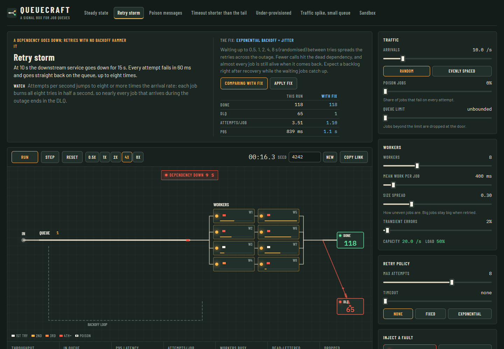
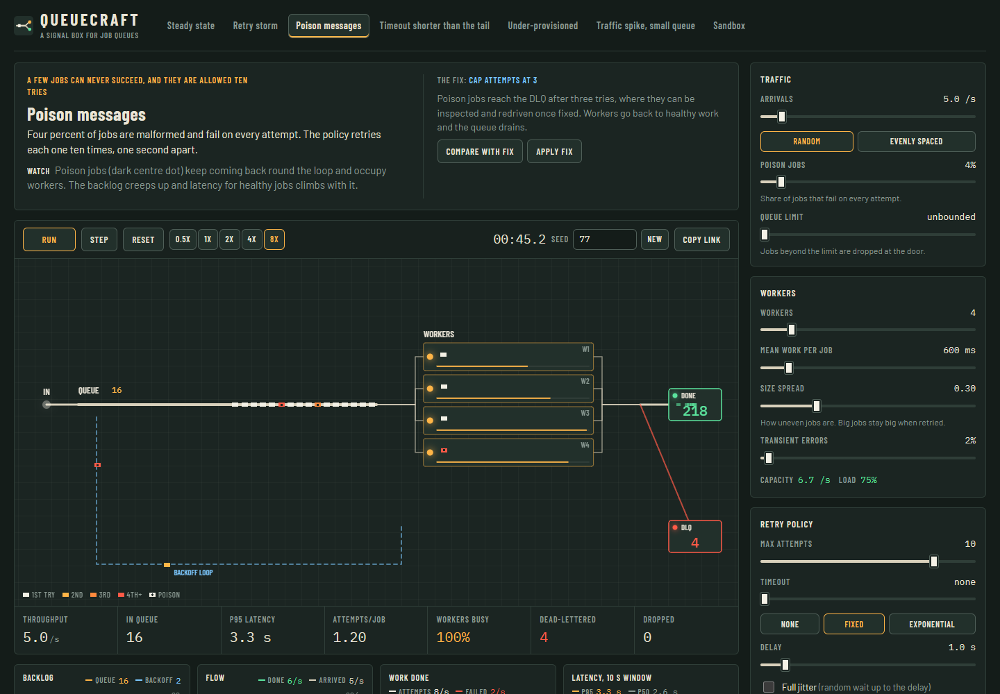

# Queuecraft

A signal box for job queues. Queuecraft simulates a producer, a queue, a pool of workers, a retry policy with
backoff, timeouts and a dead-letter queue, and draws the whole thing as a mosaic track panel you can watch and poke.
Break the dependency, crash workers, flood it with traffic, and see what your retry policy actually does.



The simulation is a deterministic discrete-event engine. Same seed and settings, same run, regardless of frame rate,
speed or how time is chunked. That is what makes the comparisons honest and the behaviour testable.

## What you can do

- **Six scenarios**, each a known failure mode with a short story, what to watch, and a fix:
  steady state, retry storm, poison messages, timeout shorter than the tail, under-provisioned, traffic spike with a
  small queue.
- **Compare with the fix.** A second, hidden run gets the same traffic and the same faults but the fixed policy.
  Its line appears dashed on the charts, and a table shows done, DLQ, attempts per job and p95 side by side.
- **Change anything live:** arrival rate and pattern, poison share, queue limit, workers, mean work, size spread,
  transient error rate, max attempts, timeout, backoff (none, fixed, exponential), base and max delay, full jitter.
- **Inject faults** for 5, 10 or 20 s: dependency outage, dependency slowdown, traffic spike, worker crash.
- **Trace a job.** Click any car on the panel (or a busy worker, or a DLQ entry) to see its attempts on a timeline,
  with outcome, worker and duration for each.
- **Dead-letter queue** with redrive: send every dead job back with a fresh attempt budget.
- **Readouts and charts:** throughput, queue, p95 latency, attempts per finished job, worker utilisation, DLQ,
  drops; backlog, flow, work done and latency over the last 90 s.
- **Share a run.** The URL always holds scenario, seed and settings; *Copy link* puts it on the clipboard.
- Transport: run/pause, step 100 ms, reset, 0.5x to 8x, seed. Keys: `Space` run/pause, `.` step, `R` reset.

## The model

| Part | Behaviour |
|------|-----------|
| Arrivals | Random (Poisson) or evenly spaced at the set rate. A spike multiplies the rate. |
| Queue | FIFO. With a limit, arrivals and retries beyond it are dropped. "Unbounded" stops at 50,000. |
| Job size | Each job has a size drawn once (lognormal). Most of the spread lives in the job, so a big job is slow on every retry; a smaller part is fresh per attempt. |
| Attempt | Duration = mean x size x noise. Fails with the transient error rate, always for poison jobs. |
| Timeout | The worker gives up at the timeout; the attempt counts as failed. |
| Retry | Up to max attempts, then the DLQ. Delay: none, fixed, or exponential with a cap; full jitter waits a random time between 0 and the delay. |
| Outage | Every attempt fails after 60 ms. |
| Slowdown | Attempts take 6x longer. |
| Crash | Half of the live workers die; their in-flight attempts fail and are retried. They come back when the fault ends. |

Separate random streams for arrivals, attempts, backoff, poison and size mean that changing the retry policy does not
change the traffic, which is why the main run and the fix run can be compared job for job.

**Not modelled:** dependency overload feedback (so no self-sustaining metastable storms), visibility-timeout
redelivery and duplicate processing, priorities, multiple queues, autoscaling, network costs.

## Run it

Needs Node 20 or newer (built with Node 24).

```bash
npm install
```

```bash
npm run dev
```

Open http://localhost:5180.

Production build and preview:

```bash
npm run build
```

```bash
npm run preview
```

Preview serves on http://localhost:4319.

## Checks

```bash
npm run verify
```

Runs `svelte-check` (types, warnings fail), ESLint, the unit tests and the production build.

```bash
npm run test:e2e
```

Builds, starts the preview server and runs Playwright in desktop and Pixel 7 viewports. It uses the installed Google
Chrome (`channel: 'chrome'`), so no browser download is needed.

What the tests cover:

- **Engine (25 tests):** determinism across frame chunking, job conservation through outages, crashes and spikes,
  arrival rates, retry and DLQ rules, exact timeouts, backoff gaps and jitter bounds, crash and recovery, worker count
  changes mid-run, bounded queues, redrive, sampling, and the ghost run seeing the same traffic and faults.
- **Scenario claims (7 tests):** each scenario card makes a quantitative claim ("attempts reach eight times arrivals",
  "the backlog grows about four a second", "workers over 90% busy, about 60% with the fix"). The tests run the problem
  and the fix and check those numbers, so the text cannot drift from the simulation.
- **Share links (3 tests):** round trip, garbage input, hand-edited values clamped.
- **End to end (7 tests x 2 viewports):** time advances and jobs finish, pause and step, the retry-storm flow from
  outage banner to DLQ trace to redrive to compare, hand-injected faults, settings surviving a reload, a broken link
  falling back with a notice, no horizontal scroll, the panel actually painted.

## Stack and layout

Svelte 5 with TypeScript, built by Vite. The panel and charts are hand-drawn Canvas 2D; there is no chart or
animation library. Fonts (Barlow, Barlow Condensed, IBM Plex Mono) are bundled through Fontsource, so it works offline.

```
src/
  engine/       simulation, no DOM: rng, config, backoff, heap/deque, simulation, scenarios, lab (main + ghost)
  render/       canvas panel: layout (wide and tall), palette, renderer
  ui/           Svelte components: SignalPanel, Controls, Slider, StripChart, Inspector
  lib/          share links, number formatting
  App.svelte    state, animation loop, page layout
tests/
  unit/         Vitest
  e2e/          Playwright
scripts/capture.mjs   regenerates the README screenshots from a running preview
docs/EVALUATION.md    why this project was picked out of 26
```

## Limitations

- Desktop browsers and phones were checked in Chrome only. Firefox and Safari have not been tested.
- The panel shows as many queued jobs as fit on the track and counts the rest. Worker bays get small at 24 workers on
  a phone.
- The canvas is decorative for screen readers; the readouts, charts captions, DLQ list and signal log carry the same
  information in text. Picking a job on the canvas needs a pointer; DLQ jobs can be opened from the keyboard.
- `npm audit` reports two low-severity advisories in `deepmerge`, pulled in by the Svelte Vite plugin at build time.
  Nothing from it ships in the bundle.
- Runs live in memory only; nothing is saved besides the URL.


